# XENOPHORA — GPU Pipeline & Systems Architecture

XENOPHORA is engineered as a bare-metal, zero-dependency WebGL2 multi-pass graphics and audio engine designed to sustain **160–192 FPS** on consumer GPUs while remaining completely immune to Windows ANGLE/D3D11 shader-compile stalls and GPU TDR (Timeout Detection and Recovery) crashes.

---

## Multi-Pass WebGL2 FBO Pipeline

Every frame executes up to **6 coordinated GPU passes** across **14 offscreen Framebuffer Objects**:

```mermaid
flowchart LR
  subgraph PDE["Pass 1 · Live A-Life PDE (256x256 RGBA16F)"]
    P0["Ping FBO"] -->|Operator-Split CGLE| P1["Pong FBO"]
    P1 -->|2 substeps / frame| P0
    P1 -.->|15 Hz readback| HUD["HUD 108x108 Monitor"]
  end

  subgraph PICK["On-Demand Pass · 1x1 Ray-Pick"]
    CLK["3D Click / Dbl-Click"] --> RP["buildRaypickFS (1x1 RGBA8)"]
    RP -->|"(trapU, trapV)"| P1
    RP -->|Exact Depth| CAM["Optical Rack Autofocus"]
  end

  subgraph TRACE["Pass 2 · 4D Spectral Raymarcher (HDR RGBA16F)"]
    P1 -->|uPdeTex| RM["Per-Regime Raymarch FS"]
    RM -->|"Primary + Volumetrics + Bounce"| SC["Scene HDR FBO"]
  end

  subgraph ACC["Pass 3 · Temporal / 256-SPP Path Refine"]
    SC --> TA["Accum Resolve FS"]
    H0["History Ping"] <--> TA
    TA --> H1["Resolved HDR"]
  end

  subgraph BLOOM["Pass 4 · 4-Mip Dual-Filter Kawase Bloom"]
    H1 --> BP["Prefilter (thresh 1.05)"]
    BP --> D0["Mip 0..3 Downsample"]
    D0 --> U0["Mip 3..0 Tent Upsample"]
  end

  subgraph FINAL["Pass 5 · Filmic Grade & Display"]
    H1 --> COMP["Composite FS"]
    U0 --> COMP
    COMP -->|"Radial CA + ACES + Dither"| SCREEN["Canvas Backbuffer"]
  end
```

---

## Framebuffer Inventory & Precision Strategy

| Target | Resolution | Internal Format | Role |
| :--- | :--- | :--- | :--- |
| `pdeFbos[0..1]` | `256 × 256` | `RGBA16F` (`REPEAT`, `LINEAR`) | Ping-pong Complex Ginzburg–Landau state `(Re A, Im A, ribRelief, defectVorticity)` |
| `pdeVisFbo` | `108 × 108` | `RGBA8` | Live top-right `CGLE CHIMERA` preview blit |
| `pickFbo` | `1 × 1` | `RGBA8` | Universal cross-driver 3D cursor pick `(trapU, trapV, depth/12, hitFlag)` |
| `sceneFbo` | Dynamic (`560p`–`1440p`) | `RGBA16F` | Raw linear HDR single-sample raymarch radiance |
| `accumFbos[0..1]` | Matches `sceneFbo` | `RGBA16F` | Ping-pong temporal TAA (live mode) & `1/N` Monte Carlo path refine (`1..256 SPP`) |
| `bloomMips[0..3]` | `1/2`, `1/4`, `1/8`, `1/16` | `RGBA16F` | Kawase bloom prefilter & downsample chain |
| `bloomUps[0..3]` | `1/2`, `1/4`, `1/8`, `1/16` | `RGBA16F` | Dedicated tent-filter upsample pyramid (avoids `RGBA16F` hardware float-blend hazards) |

### Why `RGBA16F` + Dedicated Upsample Targets?
- In WebGL2 core, `RGBA16F` textures are **always linearly filterable** once `EXT_color_buffer_float` (or `EXT_color_buffer_half_float`) is enabled, without requiring `OES_texture_float_linear`.
- Using separate `bloomUps` targets rather than `gl.enable(gl.BLEND)` on float FBOs guarantees deterministic execution across Direct3D11/12 (ANGLE), Metal, Vulkan, and SwiftShader drivers.
- Encoding `1×1` ray-pick data into `RGBA8` (`[0..1]` normalized UVs and `depth / 12.0`) eliminates driver-specific `gl.readPixels(..., gl.FLOAT)` failures across browsers.

---

## ANGLE / HLSL Compiler & GPU TDR Defenses

Complex raymarching shaders frequently fail on Windows browsers because Chromium's ANGLE compiler aggressively inlines and unrolls loops into massive HLSL shaders that either stall compilation for 10+ seconds or exceed Windows' 2-second GPU TDR watchdog. XENOPHORA implements **five explicit defenses**:

1. **Per-Regime Lazy Specialization (`#define REGIME_ID`):** Each of the 6 regimes compiles into its own lean, branch-free program (`src/shaders/raymarch.glsl.js`) on demand (~150–250ms compile time, maximal GPU register occupancy).
2. **`ZERO` Anti-Unroll Loop Barriers:** All loops (`calcNormal`, `calcAO`, `calcShadow`, `traceBounce`, primary march) initialize at `int zero = int(min(uFrame, 0.0))`, preventing ANGLE from unrolling `mapScene` 4×–88× inline.
3. **Bounding-Volume Early Exits:** Every fractal SDF checks a cheap analytical envelope (`dDome`, `dCliffMask`, `dOuter`, `dEnvAll`, `dBound`) before executing its 4D/Kleinian/KIFS fold loop.
4. **Surface-Proximity PDE Gating:** Texture fetches to `uPdeTex` inside `mapScene` execute only when `detailed && abs(d) < 0.06`, cutting ~96% of empty-space float texture lookups with zero visual degradation.
5. **Automatic Software-GPU Detection & Adaptive Scaling:** `renderer.js` inspects `WEBGL_debug_renderer_info` for software rasterizers (`SwiftShader`, `llvmpipe`, `Basic Render`), dynamically scaling step counts and internal resolution caps (`uMaxSteps`, `uBounceSteps`) while also lowering trace scale (`0.78×`) during rapid orbital drags and snapping instantly to `1.0×` native crispness on release or during Path Refine.

---

## Numerical Stability of the CGLE PDE

Forward-Euler integration of the Complex Ginzburg–Landau equation suffers from Nyquist checkerboard blowup whenever dispersive imaginary diffusion dominates real damping. `src/shaders/pde.glsl.js` uses **Lie–Trotter Operator Splitting**:

1. **9-Point Isotropic Complex Diffusion:** Uses maximally rotationally symmetric weights (`0.2` cardinals, `0.05` diagonals, `-1.0` center) with damped imaginary dispersion (`diffReal = 0.26`, `diffImag = 0.11 * clamp(c1, -1.5, 1.5)`).
2. **Exact Analytical Stuart–Landau Reaction:** Integrates $\frac{dA}{dt} = A - (1 + i c_2)|A|^2 A$ in closed form:
   $$r_{\text{next}} = \frac{r}{\sqrt{e^{-2\Delta t} + r^2(1 - e^{-2\Delta t})}}, \qquad \Delta\phi = -c_2 r^2 \Delta t$$
   eliminating radial overshoot completely and guaranteeing smooth, perpetual spiral waves and sparse defect cores.

---

## Web Audio Modal Synthesis Graph

`src/engine/audio.js` constructs a pure Web Audio API resonant acoustic engine with zero external samples:

- **Sub-Harmonic Abyssal Drone:** 4 detuned sine/triangle oscillators (`0.5×, 1.0×, 1.5×, 2.003×` root frequency per specimen scale) routed through a resonant low-pass filter whose cutoff tracks live `4D Clifford θ` and CGLE dispersion `c1`.
- **Modal Piezo-Glass Bell Pluck:** Triggered whenever `rayPick()` hits a 3D surface fold or the PDE monitor is clicked; excites 3 inharmonic plate partials (`1.0, 2.756, 5.404`) with pitch quantized to the active specimen's scale (`Lydian Abyss`, `Glass Cathedral`, `Iridescent Major 9`, `Porcelain Pentatonic`, `Obsidian Phrygian`, `Alien Whole-Fifth`).
- **Cross-Coupled Stereo Shimmer Delay:** Asymmetric `0.37s` (L) / `0.53s` (R) feedback delay lines bridged through a `3.4 kHz` warm damping filter.
